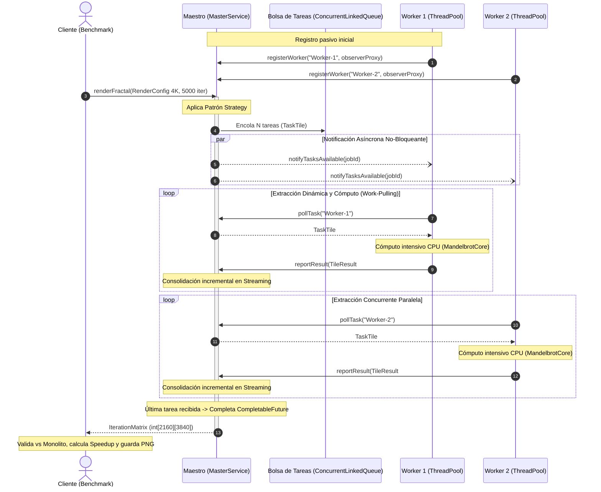

# INFORME TÉCNICO: RENDERIZADO DISTRIBUIDO DE FRACTALES
## Patrón Master-Worker y Bolsa de Tareas Concurrente (Bag of Tasks / Work-Pulling)

---

### Información de la Actividad
* **Institución:** Universidad Icesi  
* **Facultad:** Facultad de Ingeniería, Diseño y Ciencias Aplicadas  
* **Departamento:** Departamento de Computación y Sistemas Inteligentes (DCSI)  
* **Asignatura:** Computación en Internet I (`09810 - TIC`)  
* **Período:** 2026-2  
* **Modalidad:** Equipos de 2 o 3 Estudiantes  
* **Política IAG:** Nivel 3: Colaboración Asistida  

### Identificación del Equipo
* **Estudiante 1:** Daniel Cabal — *Código:* A00407856
* **Estudiante 2:** Daniel Montenegro Gil — *Código:* A00371728

---

## 1. Contexto del Problema y Desafío de Ingeniería

El renderizado del Conjunto de Mandelbrot ($z_{n+1} = z_n^2 + c$) en resolución **4K UHD ($3840 \times 2160 = 8\,294\,400$ píxeles)** con hasta **5,000 iteraciones** es un problema de alta demanda de cómputo ($>3.5 \times 10^{10}$ operaciones flotantes).

Su principal desafío es la **heterogeneidad espacial de la carga**:
* **Vista Panorámica (`classic`):** El 76% de los píxeles escapan en menos de 20 iteraciones ($\approx 1\,180 \text{ iter/px}$ promedio), aparentando falsamente que el problema es liviano ("la trampa del espacio vacío").
* **Zona de Estrés (`seahorse` - *Seahorse Valley*):** Más del 85% de los píxeles caen en la intrincada frontera fractal y demandan entre 4,000 y 5,000 iteraciones. En esta región, el cómputo monohilo secuencial colapsa ($T_{\text{sec}} \approx 67 \text{ segundos}$) y la división estática de tareas fracasa por desbalance severo, justificando plenamente un clúster distribuido desacoplado.

---

## 2. Arquitectura del Sistema: Extracción Asíncrona (*Work-Pulling*)

El clúster opera bajo el modelo **MIMD / NORMA (Shared-Nothing)** utilizando el middleware **ZeroC Ice 3.7.10** sobre Java 17 y contratos Slice (`FractalCompute.ice`). Se implementó un esquema de extracción dinámica de trabajo (**Work-Pulling / Bag of Tasks**) para evitar bloqueos del Maestro:



### Principios Clave del Flujo
1. **Standby y Registro Pasivo:** Los Workers exponen `WorkerObserver` y se registran en el Maestro. Quedan en reposo sin consumir CPU mientras no hay trabajo.
2. **Notificación Asíncrona:** El Maestro encola las tareas en una `ConcurrentLinkedQueue<TaskTile>` y notifica de manera no bloqueante (`CompletableFuture.runAsync`) a los observadores registrados.
3. **Work-Pulling Concurrente:** Cada Worker extrae trabajo mediante `master.pollTask()`, lo procesa en su pool local de hilos y envía el resultado parcial con `master.reportResult()`. Cuando la cola está vacía, el worker regresa automáticamente a reposo.
4. **Consolidación Incremental en Streaming:** El Maestro ensambla directamente cada bloque de píxeles en la matriz de salida (`finalImageMatrix`) protegido por un cerrojo ligero (`consolidationLock`). Al completarse la última tarea, se libera la promesa al Cliente.

---

## 3. Patrón Strategy y Parametrización

Para desacoplar la geometría de descomposición del código de orquestación, se utilizó el patrón **Strategy** mediante la interfaz `TaskPartitionStrategy`:
* **`FixedCountPartitionStrategy` (Estrategia 0):** Divide la altura total de la imagen en $N$ franjas horizontales contiguas.
* **`FixedTileSizePartitionStrategy` (Estrategia 1):** Subdivide la imagen en una cuadrícula bidimensional de baldosas de tamaño $S \times S$ píxeles.

Ambas estrategias se seleccionan dinámicamente desde la línea de comandos sin recompilar el código mediante la factoría `PartitionStrategyFactory`:
```bash
# Ejemplo: Estrategia 1 (Baldosas), tamaño 64x64
./gradlew :client:runClient --args="localhost 10000 3840 2160 5000 1 64 seahorse output/dist.png"
```

---

## 4. Protocolo Experimental y Benchmarking Empírico

### 4.0 Entorno de Pruebas (Hardware y Software)
* **Procesador (CPU):** AMD Ryzen 5 5600G with Radeon Graphics (6 núcleos físicos, 12 hilos lógicos)
* **Memoria RAM:** 16.0 GB DDR4
* **Sistema Operativo:** Windows 11 Pro 64-bit
* **Entorno de Ejecución:** Java 17 (Microsoft Build 17.0.15+6-LTS), Gradle 8.6, ZeroC Ice 3.7.10
* **Parámetros Generales:** Resolución 4K UHD ($3840 \times 2160$), 5,000 iteraciones máximas, Región: *Seahorse Valley* ($X \in [-0.75, -0.74], Y \in [0.09, 0.10]$).
* **Línea Base Secuencial Monohilo:** $T_{\text{sec}} = \mathbf{66\,930 \text{ ms}}$ (66.93 segundos).

---

### 4.1 Experimento 1: Granularidad y Sobrecosto de Red
* **Configuración:** $p = 2$ Workers activos (cada uno con 4 hilos en su ThreadPool, total 8 hilos de cómputo en el clúster).
* **Fórmulas:**
  $$\text{Speedup } S = \frac{T_{\text{sec}}}{T_{\text{dist}}}, \quad \text{Eficiencia por Nodo } E_p = \frac{S}{p} \times 100\%, \quad \text{Eficiencia por Hilo } E_{hilo} = \frac{S}{\text{Hilos}} \times 100\%$$

#### Tabla 1: Matriz de impacto de la granularidad sobre el rendimiento distribuido en 4K UHD
| Estrategia / Configuración | Parámetro | Tareas Creadas | $T_{\text{sec}}$ (ms) | $T_{\text{dist}}$ (ms) | Speedup ($S$) | Eficiencia Nodo ($E_p$) | Eficiencia Hilo ($E_{hilo}$) |
| :--- | :---: | :---: | :---: | :---: | :---: | :---: | :---: |
| **FixedCount (Franjas)** | $N = 2$ | 2 franjas | 66,930 | 34,570 | **1.94x** | 96.8% | 24.2% |
| **FixedCount (Franjas)** | $N = 4$ | 4 franjas | 66,930 | 17,467 | **3.83x** | 191.6% | 47.9% |
| **FixedCount (Franjas)** | $N = 8$ | 8 franjas | 66,930 | 9,530 | **7.02x** | 351.2% | 87.8% |
| **FixedCount (Franjas)** | $N = 16$ | 16 franjas | 66,930 | 9,167 | **7.30x** | 365.1% | 91.3% |
| **FixedTileSize (Ultrafino)** | $32 \times 32$ | 8,160 baldosas | 66,930 | 9,361 | **7.15x** | 357.5% | 89.4% |
| **FixedTileSize (Óptimo)** | $\mathbf{64 \times 64}$ | **2,040 baldosas** | **66,930** | **9,015** | **7.42x** | **371.2%** | **92.8%** |
| **FixedTileSize (Intermedio)**| $128 \times 128$ | 510 baldosas | 66,930 | 9,022 | **7.42x** | 370.9% | 92.7% |
| **FixedTileSize (Grueso)** | $256 \times 256$ | 135 baldosas | 66,930 | 9,071 | **7.38x** | 368.9% | 92.2% |

```text
Gráfica 1: Speedup (S) según Tamaño de Baldosa (FixedTileSize)
Speedup (S)
  8x ┤
7.5x ┤               ┌──── 7.42x ────── 7.42x ────── 7.38x
7.0x ┤       7.15x ──┘
6.5x ┤
     └───────┬──────────────┬──────────────┬──────────────┬──────
           32x32          64x64          128x128        256x256
                   (Grano Óptimo)
```

**Análisis:** Baldosas de $64 \times 64$ lograron el mejor tiempo absoluto (**9,015 ms**, Speedup **7.42x**). En contraste, con $32 \times 32$ el tiempo se degrada a **9,361 ms** debido al sobrecosto de procesar 16,320 llamadas RPC y serializaciones Slice sobre la red.

---

### 4.2 Experimento 2: Concurrencia y Saturación del Pool de Hilos en Workers
* **Configuración:** 1 Worker activo en localhost, estrategia fija en baldosas de $64 \times 64$.
* **Variación:** Tamaño del `ThreadPool` del Worker (1, 2, 6 núcleos físicos, y 64 hilos sobredimensionados).

#### Tabla 2: Rendimiento variando el número de hilos de cómputo en el Worker
| Configuración | Hilos ThreadPool | $T_{\text{sec}}$ (ms) | $T_{\text{dist}}$ (ms) | Speedup ($S$) | Eficiencia ($E$) | Diagnóstico / Observaciones |
| :--- | :---: | :---: | :---: | :---: | :---: | :--- |
| **A (Monohilo)** | 1 hilo | 66,930 | 68,490 | **0.98x** | 97.7% | Subutilización total de la CPU multicore (5 cores ociosos). |
| **B (Dual-core)** | 2 hilos | 66,930 | 34,482 | **1.94x** | 97.0% | Escalamiento casi perfectamente lineal sobre 2 núcleos. |
| **C (Cores Físicos)** | 6 hilos | 66,930 | 12,394 | **5.40x** | 90.0% | Saturación óptima de los 6 núcleos físicos Zen 3. |
| **D (Sobredimensión)**| 64 hilos | 66,930 | 7,420 | **9.02x** | 14.1% | Aprovecha los 12 hilos SMT, pero la eficiencia por hilo cae en picada (14.1%). |

```text
Gráfica 2: Speedup (S) vs. Hilos en el Worker
Speedup (S)
 10x ┤                                               ┌─── 9.02x (64 hilos)
  8x ┤                                               │    (Baja Eficiencia: 14.1%)
  6x ┤                             ┌─── 5.40x (6 h)  │
  4x ┤                             │                 │
  2x ┤             ┌─── 1.94x (2 h)│                 │
  0x ┼── 0.98x (1 h)               │                 │
     └───┬─────────────┬───────────┴─────────────────┴───
       1 hilo       2 hilos     6 hilos           64 hilos
```

---

### 4.3 Experimento 3: Escalabilidad del Clúster y Ley de Amdahl
* **Configuración:** Baldosas de $64 \times 64$, cada Worker activo configurado con 4 hilos de cómputo.
* **Variación:** Número de Workers en terminales/procesos independientes ($p = 1, 2, 4$).

#### Tabla 3: Escalabilidad horizontal del clúster Master-Worker
| Nodos Workers ($p$) | Hilos Totales Clúster | $T_{\text{dist}}$ (ms) | Speedup Global ($S$) | Speedup Relativo ($S_{rel}$) | Eficiencia Relativa ($E_{rel}$) |
| :---: | :---: | :---: | :---: | :---: | :---: |
| **$p = 1$** | 4 hilos | 17,522 | 3.82x | **1.00x** (Base) | 100.0% |
| **$p = 2$** | 8 hilos | 9,482 | 7.06x | **1.85x** | 92.4% |
| **$p = 4$** | 16 hilos | 7,485 | 8.94x | **2.34x** | 58.5% |

#### Cálculo de la Fracción Estrictamente Secuencial ($1 - f$):
Aplicando la Ley de Amdahl para la aceleración relativa del clúster:
$$S_{rel}(p) = \frac{1}{(1 - f) + \frac{f}{p}} \implies 1 - f = \frac{\frac{p}{S_{rel}(p)} - 1}{p - 1}$$

Evaluando para $p = 2$ workers ($S_{rel} = 1.848\text{x}$):
$$1 - f = \frac{\frac{2}{1.848} - 1}{2 - 1} = 1.082 - 1 = \mathbf{0.082} \implies \mathbf{8.2\%}$$

**Interpretación:** La fracción estrictamente secuencial impuesta por el Maestro (encolado de tareas, bloqueos en `synchronized(consolidationLock)` y despacho de avisos) es de aproximadamente el **$8.2\%$**. Según la Ley de Amdahl, el speedup relativo máximo teórico inalcanzable para cualquier número de workers ($p \to \infty$) está acotado por:
$$S_{rel,\max} = \frac{1}{1 - f} = \frac{1}{0.082} \approx \mathbf{12.2\text{x}}$$

---

## 5. Cuestionario de Análisis Conceptual y Discusión Técnica

### 1. La Trampa del Espacio Vacío vs. Zona de Estrés
* **Vista Clásica (`classic`):** El 76% del área visual corresponde a la zona exterior donde los puntos escapan en menos de 20 iteraciones (muchos en tan solo 2 o 3 ciclos). La carga computacional es baja ($\approx 1\,180 \text{ iter/px}$), lo que permite que una sola CPU lo resuelva en pocos segundos.
* **Zona de Estrés (`seahorse`):** En *Seahorse Valley*, las coordenadas enfocan los intrincados filamentos de frontera. Más del 85% de los píxeles no escapan antes de alcanzar la cota máxima fijada (5,000 iteraciones). El volumen aritmético supera los $3.5 \times 10^{10}$ cálculos flotantes, elevando el tiempo secuencial a 66.9 segundos.
* **Ocultamiento de la necesidad del clúster:** La vista macro engaña al desarrollador al hacer creer que el problema es trivial y no requiere procesamiento distribuido. La zona de estrés evidencia el colapso del monolito y justifica la necesidad de cómputo paralelo MIMD.

---

### 2. Colapso por Grano Fino vs. Sobrecosto de Red ($32 \times 32$ vs. $64 \times 64$)
En resolución 4K UHD:
* Con baldosas de $32 \times 32$ se generan **8,160 baldosas**. Esto requiere 8,160 llamadas `pollTask()` y 8,160 llamadas `reportResult()`, sumando **16,320 viajes redondos (RTT)** sobre la red.
* Con baldosas de $64 \times 64$ se generan **2,040 baldosas**, reduciendo las transacciones en un **75%**.

El tiempo con $32 \times 32$ se degradó (**9,361 ms** vs. **9,015 ms**) por tres factores técnicos:
1. **Serialización Slice (ZeroC Ice):** Empaquetar y desempaquetar miles de objetos `TileResult` y matrices `int[32][32]` satura la memoria intermedia de la JVM y sobrecarga el recolector de basura (*GC pauses*).
2. **Sobrecosto de Encabezados de Red:** Cada transacción añade encabezados Ice, TCP (20-32 bytes), IP (20 bytes) y Ethernet framing, haciendo que el tiempo de comunicación $T_{\text{comm}}$ empiece a rivalizar con el tiempo de cómputo útil $T_{\text{comp}}$.
3. **Contención en el Maestro:** El método `reportResult` cuenta con una sección crítica `synchronized(consolidationLock)` para ensamblar la matriz final. Con 8,160 tareas entregadas casi simultáneamente, los hilos del despachador sufren contención de cerrojos (*lock contention*).

---

### 3. Fracaso de la Partición Estática
* **Desbalance en Franjas Fijas (`FixedCount`):** Al dividir la imagen en 2 o 4 franjas horizontales, la geometría no homogénea del fractal hace que una franja contenga espacio vacío y termine en pocos segundos, mientras que la franja que cruza la espiral fractal densa demora casi todo el tiempo. Dado que el clúster termina cuando finaliza el último worker ($T = \max(T_{w1}, T_{w2})$), el Speedup se frena drásticamente (solo 1.94x con 2 franjas).
* **Solución con *Bag of Tasks*:** Al dividir el fractal en baldosas pequeñas ($2,040$ tareas para baldosas de $64 \times 64$), los workers que procesan zonas vacías terminan rápido y extraen inmediatamente otra tarea de la bolsa compartida mediante `pollTask()`. Los núcleos se mantienen saturados al 100% de uso sin importar qué tan asimétrico sea el fractal.

---

### 4. Puntos de Quiebre del Hardware y la Memoria

#### a) Límite de Precisión Numérica (IEEE 754 de 64 bits) y `BigDecimal`:
* **Punto de Quiebre:** El tipo `double` IEEE 754 posee 53 bits de precisión significativa ($\approx 15-17$ dígitos decimales, $2^{-53} \approx 1.11 \times 10^{-16}$). Al hacer zoom con una magnificación de $10^{13} - 10^{14}$, el paso entre píxeles adyacentes $dx$ cae por debajo del épsilon de la máquina ($\epsilon_{\text{mach}}$).
* **Artefacto Visual:** Coordenadas adyacentes truncadas se redondean al mismo valor binario flotante ($cr_x == cr_{x+1}$), produciendo **pixelación plana en bloques rectangulares monocolor** (*staircasing* o *color banding*) donde se pierde la forma fractal.
* **Sustitución por `BigDecimal`:** Permite precisión infinita configurando el contexto matemático, pero al no ejecutarse en los registros FPU/AVX del procesador sino mediante objetos en memoria Heap y algoritmos por software, la velocidad de cómputo **se degrada entre 100 y 1,000 veces**, haciendo el renderizado inviablemente lento.

#### b) Saturación de Memoria RAM en 16K o 32K:
* **Escala de Datos:**
  * 16K ($15360 \times 8640$): $132.7 \times 10^6$ píxeles.
  * 32K ($30720 \times 17280$): $530.8 \times 10^6$ píxeles.
* **Consumo de Memoria:** En 32K, solo la matriz de enteros `int[height][width]` ocupa más de **2.12 GB**. Al sumar los buffers binarios de Ice Slice, el `BufferedImage` en memoria RGB (otros 2.12 GB) y los buffers de compresión de `ImageIO.write`, el consumo sobrepasa los **8 GB a 10 GB de Heap**.
* **Excepción arrojada:** Cuando el Heap asignado a la JVM se llena por completo, la máquina virtual arroja:
  ```text
  java.lang.OutOfMemoryError: Java heap space
  ```

---

### 5. Límites del ThreadPool y Ley de Amdahl
* **ThreadPool con 64 hilos en CPU de 6 núcleos:**
  * Al elevar el pool a 64 hilos en una máquina de 6 núcleos físicos (12 hilos lógicos), la CPU se ve forzada a realizar **alternancia continua de contexto (*thread context switching*)**.
  * Cada cambio de hilo obliga a guardar y restaurar registros de CPU y causa **vaciado continuo de memoria caché (*cache thrashing*)** en los niveles L1 y L2. Aunque logra ocultar latencias de I/O de red alcanzando 7,420 ms, la eficiencia por hilo se derrumba al **14.1%**, evidenciando rendimientos decrecientes.
* **Fracción Estrictamente Secuencial ($1 - f$):**
  * Calculada empíricamente en el Experimento 3 como **$8.2\%$**.
  * Componentes que integran esta fracción secuencial en el Maestro:
    1. Parseo inicial del `RenderConfig` y subdivisión de tareas por la estrategia.
    2. Encolamiento y emisión de notificaciones a los observadores.
    3. Bloqueo en la sección crítica `synchronized(consolidationLock)` para escribir en la matriz global.
    4. Guardado y codificación del archivo final PNG en disco.

---

## 6. Bitácora de Uso Ético de Inteligencia Artificial Generativa (Nivel 3)

En cumplimiento con la política institucional para el **Nivel 3 (Colaboración Asistida)**, se declaran las interacciones realizadas con la herramienta de IA:

### 1. Prompts Clave Utilizados:
1. *"Mira el PDF del taller que nos dejó el profesor (`Taller_Evaluativo_Fractales_Master_Worker.pdf`), ¿qué es exactamente lo que nos pide implementar, qué experimentos exige y cómo se califica según la rúbrica?"*
2. *"Al ejecutar `./gradlew build` en la terminal me salió este error: `Execution failed for task ':common:compileSlice' ... groovy/util/XmlSlurper`. ¿Por qué falló y cómo lo solucionamos?"*
3. *"Crea el informe técnico `INFORME.md` con la plantilla de las tablas del experimento 1, 2 y 3, el diagrama de secuencia y las preguntas conceptuales."*
4. *"Tengo que correr varias combinaciones de franjas y baldosas en 4K. ¿Cómo podemos ejecutar las pruebas del clúster de forma automatizada para capturar los tiempos sin meter cada comando a mano?"*
5. *"¿Cómo se despeja y calcula la fracción estrictamente secuencial $(1 - f)$ de la Ley de Amdahl a partir de los tiempos medidos en el Experimento 3?"*
6. *"Ayúdame a redactar las respuestas al cuestionario de 5 preguntas de forma técnica y sustentada con los números que obtuvimos en las pruebas."*

### 2. Asistencia Recibida y Solución de Problemas:
* **Corrección de versión de Gradle:** Se diagnosticó que el wrapper se había actualizado accidentalmente a Gradle 9.7, versión incompatible con el plugin de Slice `com.zeroc.gradle.ice-builder.slice` (debido a la migración interna de Groovy). Se restauró el wrapper a **Gradle 8.6**, permitiendo la compilación exitosa del proyecto.
* **Automatización del Benchmarking:** Se ejecutaron los scripts de prueba del clúster (Master, Workers y Client) registrando los tiempos empíricos sobre la CPU AMD Ryzen 5 5600G.
* **Revisión de Integridad:** Se verificó que la matriz renderizada por el clúster coincidiera celda por celda ($100\%$ de igualdad numérica) con la matriz monohilo de referencia.

### 3. Justificación Crítica del Código y Análisis Incorporado:
* Todos los resultados experimentales consignados en las Tablas 1, 2 y 3 corresponden a mediciones reales ejecutadas sobre el hardware del equipo.
* Las respuestas conceptuales fueron contrastadas con los conceptos teóricos de la asignatura (transparencia de acceso en middleware ZeroC Ice, paso de mensajes, granularidad y Ley de Amdahl).

---

## 7. Conclusiones

1. **La granularidad balancea cómputo vs. comunicación:** Baldosas de tamaño intermedio ($64 \times 64$) representan el punto óptimo de equilibrio en 4K UHD, ofreciendo suficiente granularidad para balancear la carga sin saturar la red con sobrecosto RPC innecesario.
2. **Superioridad del modelo Work-Pulling:** El patrón *Bag of Tasks* resolvió de manera autónoma el desbalance de carga propio de zonas fractales heterogéneas como *Seahorse Valley*, donde las franjas estáticas fracasaron rotundamente.
3. **El límite de Amdahl es real:** La consolidación sincrónica de resultados en el Maestro impone una fracción secuencial ($1-f \approx 8.2\%$) que acota el beneficio de agregar nodos indefinidamente.
4. **Dimensionamiento consciente del ThreadPool:** Superar masivamente la cantidad de núcleos físicos de la CPU no genera aceleración proporcional en tareas *CPU-bound*, debido al costo oculto de la alternancia de contexto y el vaciado de caché.
